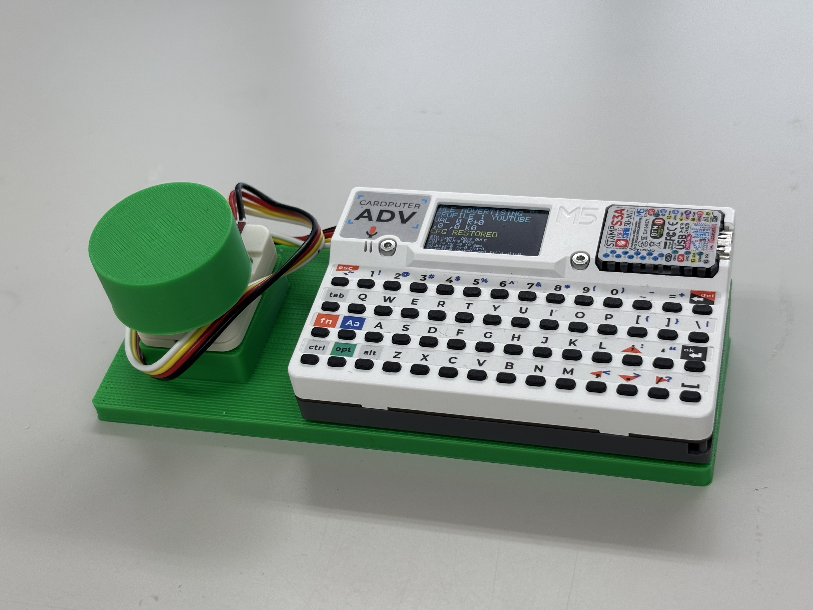

# Cardputer ADV Media Jog

**Give your Cardputer ADV a new job.**

**No drivers. No companion apps. Just plug in and control.**

The Cardputer ADV appears to the computer as a standard USB or Bluetooth LE keyboard and mouse (HID), so the operating system's built-in support is used. There is nothing to install on the computer. Standard HID still does not mean every computer, OS or application will work: see [Tested platforms](#tested-platforms-and-results) for what has actually been checked.



## What it does

Turn a large knob to control your computer:

- **YOUTUBE profile:** step a paused YouTube video frame by frame, and play/pause with a press.
- **SPINNER profile:** move the mouse pointer left and right; hold the knob to drag.
- **C-SPINNER profile:** a spinner you set up yourself: its own sensitivity, normal or reversed direction, and any key, modifier or mouse button on the knob press.
- **USB or Bluetooth LE:** connect with a cable, or wirelessly. Switch between them on the Cardputer, without restarting.
- **Everything is set on the Cardputer itself:** profile, transport, sensitivity and key assignments are chosen with the Cardputer's own keyboard and screen, and kept across power cycles.
- **Two more profiles are built in** (EDITING and CUSTOM, below).

The Cardputer's keyboard is used only for these local settings. **No Cardputer keystroke is ever sent to the computer.**

## Why I built this

Video editing isn't just for professionals anymore. But dedicated controllers with a jog dial are usually too expensive to buy on a whim. Cheap rotary knobs exist, yet many of them do little more than change the volume.

So I wanted a controller that does real work, that is set up on the device itself, and that needs no special software on the computer.

And I already had a Cardputer ADV.

Turning something already on my desk into a new, genuinely useful tool turned out to be the fun part.

## Hardware

| Part | Notes |
| --- | --- |
| M5Stack **Cardputer ADV** | Tested. The original Cardputer (non-ADV) uses a different keyboard reader and is **not** tested. |
| M5Stack **Unit Encoder (U135)** | Connected to the Cardputer's external Grove port (I²C, address 0x40). Connect it while the Cardputer is powered **off**. |
| USB-C **data** cable | For USB use. Over Bluetooth LE it is only needed for power and charging. |
| Optional: 3D-printed base (flat or 15° tilted) and jog dial | See [No 3D printer? No problem!](#no-3d-printer-no-problem) and [`hardware/`](hardware/). |

## Installation

The tested way is the **app-only firmware file**, uploaded through an app launcher that is already installed on the Cardputer and supports Wi-Fi upload.

1. Download [`firmware/MediaJog_2a_5/MediaJog_2a_5.ino.bin`](firmware/MediaJog_2a_5/) and check it against [`SHA256SUMS.txt`](firmware/MediaJog_2a_5/SHA256SUMS.txt).
2. Upload it with your launcher's Wi-Fi upload, then start it from the launcher.
3. Connect the U135 (with the Cardputer off), power on and start the app.

> **Keep your launcher:** install only the app-only `.ino.bin`, through the launcher.
> - Do not write a merged image (`*.merged.bin`) to the device with a flashing tool: it contains a bootloader and a partition table.
> - With this project's board package, the Arduino IDE's **Upload** also writes the bootloader and the partition table (per the board package's upload settings). That can replace your launcher.
> - If you build from source, use **Export Compiled Binary** and install the resulting `.ino.bin` through the launcher.

This version reads the settings saved by the earlier versions in this repository (by design; carrying them over was not tested separately). Details, building from source and recovery: [`docs/guide/installation.md`](docs/guide/installation.md). Other firmware in this repository: [`firmware/`](firmware/).

## Connecting: USB or Bluetooth LE

- **USB:** connect the Cardputer to the computer with a USB-C data cable. The screen shows `USB HID READY`.
- **Bluetooth LE:**
  1. Press `Fn + B` to open the **CONNECTION** screen, press `2` (BLE), then `ok` (Enter). Pressing the knob also applies.
  2. Pair **"MediaJog BLE"** in the computer's Bluetooth settings. No PIN is needed.
  3. The screen shows `BLE READY`.
- **Switch back to USB:** `Fn + B`, `1`, `ok`. Close the screen without changing anything with `` ` `` (esc).

The selected transport is restored at the next start. Only one transport sends at a time. When you switch, anything held (a key, a mouse button) is released first. If a release could not be confirmed, a red `!` appears next to the transport name in the top-right corner.

## Using the profiles

Select a profile with `Fn + 1` … `Fn + 5` on the Cardputer. The profile is saved.

| Profile | Turn clockwise | Turn counterclockwise | Press the knob |
| --- | --- | --- | --- |
| `Fn + 1` **YOUTUBE** | `.` (next frame on a **paused** video) | `,` (previous frame) | `k` (play / pause) |
| `Fn + 2` **SPINNER** | mouse pointer → right | mouse pointer → left | hold = left mouse button (drag) |
| `Fn + 3` **EDITING** | Right Arrow | Left Arrow | Space |
| `Fn + 4` **CUSTOM** | your key | your key | your key; **TAP** or **HOLD** |
| `Fn + 5` **C-SPINNER** | mouse pointer → right (or left, if reversed) | mouse pointer → left (or right) | your choice: key, mouse left / right or none; **TAP** or **HOLD** |

- **Sensitivity and KEY STEP:** `Fn + ;` (up) and `Fn + .` (down).
  - In **SPINNER** and **C-SPINNER**: the pointer movement per knob step, 14 steps from 1 to 128 (default 8). Each of the two profiles keeps its own value.
  - In **YOUTUBE**, **EDITING** and **CUSTOM**: **KEY STEP**, how many key presses one knob step sends (1–10, default 1), one value per profile. When you reverse direction, presses still waiting in the other direction are dropped, so the knob follows you.
- **EDITING** sends common editing shortcuts. In **Adobe Premiere Pro** on macOS, the three basic controls were checked over USB and Bluetooth LE: turning moves the playhead forward / back, and pressing the knob plays / pauses (see [Tested platforms](#tested-platforms-and-results)). Other Premiere Pro functions and other video editors are **not** tested, and full compatibility with Premiere Pro or any other editor is not claimed.
- **CUSTOM** is set up on the Cardputer with `Fn + S` (in Profile 4): an ordinary key with Ctrl / Shift / Alt / Command (GUI). The press can be TAP or HOLD; for example, HOLD Shift + turn selects text.
  - SETUP画面のアルファベットはキー名として大文字で表示されます。実際に大文字を入力するには、Shift修飾キーを追加してください。
  - (Letters on the SETUP screen are key names. To type a capital letter, add the Shift modifier.)
- **On-screen help:** in the help lines, the key to press is shown in **cyan** and what it does in **white** (for example `Fn+S` in cyan, `: SETUP` in white).

More detail: [`docs/guide/controls.md`](docs/guide/controls.md).

### C-SPINNER (`Fn + 5`)

A second spinner whose settings are all yours. It works over USB and Bluetooth LE, and leaves SPINNER (`Fn + 2`) unchanged.

- **Turning the knob** moves the mouse pointer horizontally (relative X movement).
- **Sensitivity:** the same 14 steps as SPINNER, kept separately. `Fn + ;` / `Fn + .` in Profile 5 change only C-SPINNER.
- **Setup:** `Fn + S` in Profile 5. Choose a row with `1`–`4` or by turning the knob; press the knob to change it. `ok` (Enter) saves, `` ` `` (esc) cancels.

  | Row | Setting |
  | --- | --- |
  | `1 SENS` | sensitivity |
  | `2 DIR` | NORMAL or REVERSE |
  | `3 BTN` | the knob press: a key (with Ctrl / Shift / Alt / Command, or modifiers alone), `Fn + L` mouse left, `Fn + R` mouse right, `del` none |
  | `4 MODE` | **TAP**: one key press or one click per knob press. **HOLD**: held while you hold the knob (for example, drag with the mouse button, or Shift) |

- **Defaults:** sensitivity 8, NORMAL, mouse left, HOLD: the same as SPINNER's defaults.
- **Saved** on the Cardputer: SETUP on Save, the sensitivity 2 s after the last change. Profile 5 is restored at the next start.
- With a key on HOLD, the computer reacts as to any held key: for example, macOS may show its accent menu, and other inputs may repeat the character. Use TAP for a single press.

## Tested platforms and results

Tested by the author on real hardware. **Stage 2a-5** (the firmware above) is Stage 2a-4 with colour-coded on-screen help; its control functions are the same as Stage 2a-4's, which were tested as follows.

**Stage 2a-4** on macOS (MacBook Pro, Apple Silicon):

| Connection | Tested |
| --- | --- |
| Bluetooth LE | SPINNER and C-SPINNER pointer; C-SPINNER at sensitivity 8 and 64; the two sensitivities independent; REVERSE (also after a profile switch and a power cycle); mouse left / right, TAP (three right clicks in a row; no drag) and HOLD (drag); key A (TAP, HOLD), Shift + A, none; settings kept after a power cycle |
| USB | C-SPINNER pointer |

**Stage 2a-3** (KEY STEP), on macOS: KEY STEP 10 over USB; fast turning with a sudden reversal over Bluetooth LE and USB (the knob follows the reversal); KEY STEP 1 over Bluetooth LE; CUSTOM (Right / Left, HOLD Shift) turning while holding over Bluetooth LE.

**Stage 2a-2**, tested earlier:

| OS | Connection | YOUTUBE | SPINNER |
| --- | --- | --- | --- |
| macOS (MacBook Pro, Apple Silicon) | USB | ✅ | ✅ mouse control |
| macOS | Bluetooth LE | ✅ | ✅ pointer, drag and release |
| Windows | USB | ✅ | ✅ pointer |
| ChromeOS | USB | ✅ | ✅ pointer |

**Also checked on macOS (Stage 2a-2):**
- switching USB ⇄ Bluetooth LE without a restart, including switching away from Bluetooth LE while dragging;
- automatic Bluetooth LE reconnection after turning the Mac's Bluetooth off and on, and after restarting the Cardputer (once each);
- USB reconnection after restarting the Cardputer in USB mode.

**Adobe Premiere Pro** on macOS (MacBook Pro, Apple Silicon), profile **EDITING** (`Fn + 3`):

| Action | USB | Bluetooth LE |
| --- | --- | --- |
| Turn clockwise: playhead moves forward | ✅ | ✅ |
| Turn counterclockwise: playhead moves back | ✅ | ✅ |
| Press the knob: play / pause | ✅ | ✅ |

Only these three basic controls were checked. Other Premiere Pro functions, workflows and keyboard-shortcut settings were not tested.

**Not tested yet:**
- C-SPINNER and KEY STEP on Windows and ChromeOS; Bluetooth LE on Windows and ChromeOS;
- dragging on Windows and ChromeOS;
- video editors other than Premiere Pro, such as DaVinci Resolve; in Premiere Pro, anything beyond the three basic EDITING controls above (for example, longer editing sessions or other functions);
- EDITING in Premiere Pro on Windows;
- Linux distributions (ChromeOS is **not** taken as evidence for them);
- long-term stability;
- other computers and OS versions.

**The original Cardputer** is not tested either.

The test history is in [`docs/history/`](docs/history/).

### Example: Arkanoid in the Internet Archive's web MAME

[Arkanoid Tournament (US)](https://archive.org/details/arcade_arkatour) in the Internet Archive's browser version of MAME can be played with the knob.

- **Tested with:** Mac, Google Chrome, Bluetooth LE, Stage 2a-4, **SPINNER (`Fn + 2`) at sensitivity 64 (12/14)**. C-SPINNER was **not** tried with this game.
- **Result:** the paddle follows the knob left and right at a practical speed. The movement is slightly stepped; the cause is not known.
- **Mouse input must be enabled in the web MAME.** Without it, the pointer moves but the paddle does not. What worked:
  1. Open the game page (reload it if it is already open). Do not start the game yet.
  2. In Chrome's address bar, run:
     ```
     javascript:MAMELoader.extraArgs=(z)=>({extra_mame_args:['-mouse']});AJS.emulate()
     ```
     Chrome may remove `javascript:` when you paste. If so, type `javascript:` by hand and paste the rest.
  3. The game starts with MAME's `-mouse` option, and the knob moves the paddle.
- **Getting the pointer back:** while mouse input is enabled, the pointer is captured by the game. Press **Esc** once to release it.
- This relies on the Internet Archive's page code (found in Alexander Pruss, ["Two tweaks for Internet Arcade games on archive.org"](https://alexanderpruss.blogspot.com/2023/02/two-tweaks-for-internet-arcade-games-on.html)). It may stop working at any time. Play only games you are allowed to use.

## No 3D printer? No problem!

The custom enclosure is completely optional. You can use LEGO bricks, build your own mount, or simply use the components as they are.

But take a look at the photo above. You might change your mind. 😉

The print files are in [`hardware/`](hardware/):
- a Bambu Studio project (`Cardputer-ADV-Media-Jog.3mf`) with a flat base, a 15° tilted base and the jog dial. This is what the author printed and used.
- the same three parts as STL (`MediaJog_Base_A.stl` flat base, `MediaJog_Base_B.stl` 15° tilted base, `MediaJog_Dial.stl` jog dial). They were exported from the project and checked against it, but have **not** been printed.

## Known limitations

- **Bluetooth LE, at most 2 computers.** The Bluetooth stack stores a limited number of subscription records. Pairing a **third** computer can make it delete the pairing of the oldest other computer.
- **Bluetooth LE: connected, but nothing arrives.** Twice during development the Cardputer showed `BLE READY` and counted the inputs as sent, but nothing reached the Mac. Once, removing the device on the Mac and pairing again fixed it; in the other case it later worked again. The cause is **not determined**.
- **Re-pairing after an update.** After some firmware updates the Mac kept "MediaJog BLE" but did not reconnect. Removing the device on the Mac and pairing again fixed it.
  - The cause is **not determined**. It is **not** established that every update needs a new pairing: other updates kept the pairing.
  - Do not go back to Bluetooth firmware older than Stage 2a-2. Its Bluetooth layout differs.
- **KEY STEP over Bluetooth LE.** With a high KEY STEP and fast turning, Bluetooth LE cannot send the presses as fast as they are made; they queue up and arrive late (a reversal drops the waiting ones). Over USB this was not seen.
- **First USB connection.** Once, USB stayed at `NOT MOUNTED` and the computer did not list the device at all, also after a restart with the cable connected. It worked after powering the Cardputer off and on. The cause and the exact recovery condition are **not determined**.
- **USB unplug / replug while powered.** With earlier USB builds the screen could stay at `USB SUSPENDED`; powering the Cardputer off and on restored it. The root cause is unknown. The USB code is unchanged since then.
- **Pairing and devices.** Bluetooth LE works with one computer at a time. There is no "forget pairing" on the Cardputer yet.
- **No boot-protocol keyboard.** It does not work in BIOS / firmware menus.
- **Settings storage.** Settings are kept in the Cardputer's shared NVS storage under the app's own namespace. This firmware never erases NVS, but the Arduino core can erase it after certain storage errors.

Troubleshooting: [`docs/guide/troubleshooting.md`](docs/guide/troubleshooting.md).

## Technical documents and history

- [`docs/technical/architecture.md`](docs/technical/architecture.md): how USB and Bluetooth LE HID share one firmware, profile handling, release rules, saved settings.
- [`docs/technical/ble-gatt.md`](docs/technical/ble-gatt.md): the Bluetooth LE HID service, and why it is a fixed table.
- [`docs/history/`](docs/history/): the full development and test records, stage by stage. Some of them are in Japanese.

**Ideas for later** (not implemented): pairing management on the device, more profiles for specific applications, and other input modules for a modular controller. Nothing in this list is promised.

## License and credits

- **License:** all original project materials (firmware sources, 3D-print designs, documentation, photos) are released under the [MIT License](LICENSE), Copyright (c) 2026 Kariage POMPADOUR Entertainment Corporation.
- **Third-party material** keeps its own license and is not claimed as this project's:
  - M5Stack's libraries (M5Unified, M5GFX, M5Unit-Encoder, M5Cardputer; MIT). M5Stack-derived code in this repository is covered by [`LICENSES/M5Stack-MIT.txt`](LICENSES/M5Stack-MIT.txt).
  - The Arduino-ESP32 core (mixed licenses, including LGPL-2.1 and Apache-2.0).
  - TinyUSB (MIT).
  - Apache NimBLE / ESP-IDF Bluetooth (Apache-2.0).
- **Credits:** concept, hardware design, 3D printing and real-device testing by **kariagepompadour**. AI tools (Anthropic's Claude for implementation, investigation and documentation; OpenAI's GPT for review) assisted the development. The author made the project decisions and did all hardware testing.
